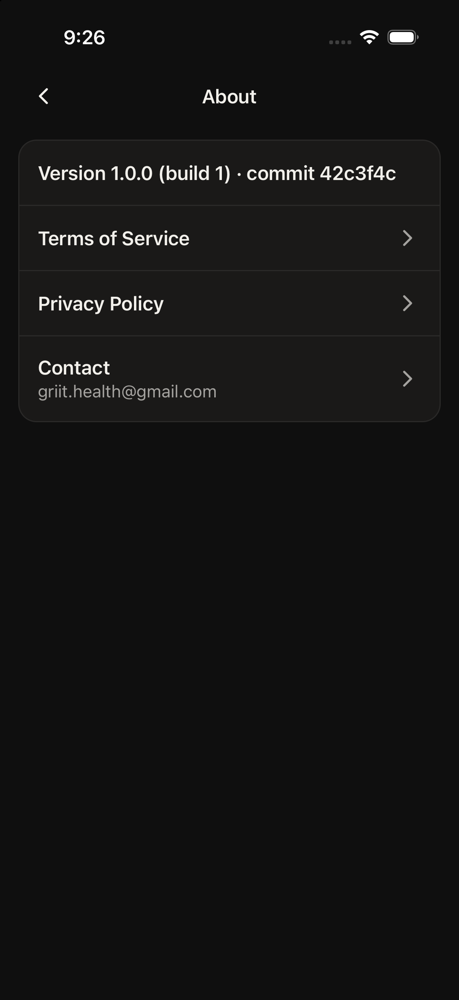
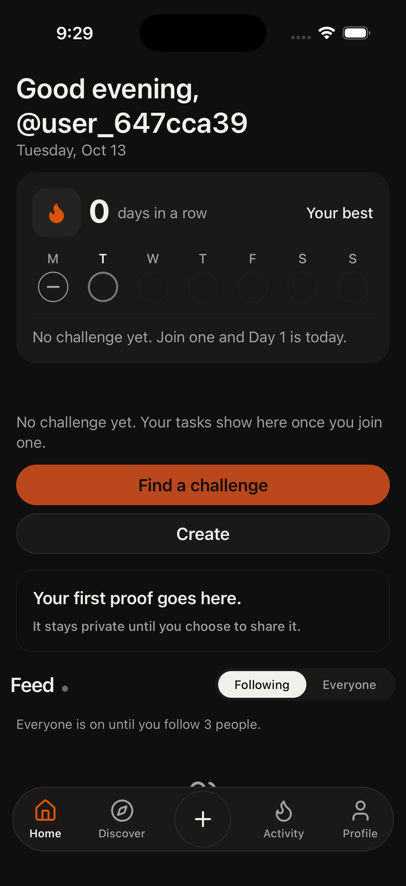
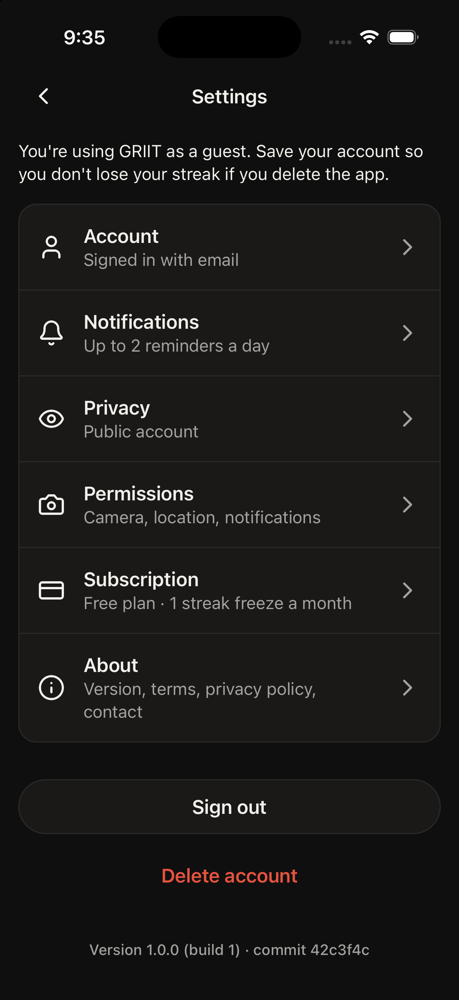
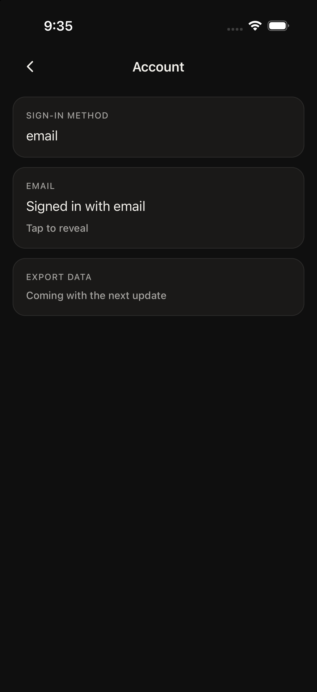
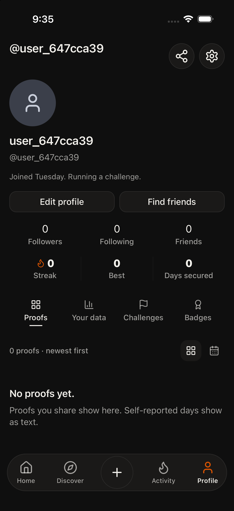
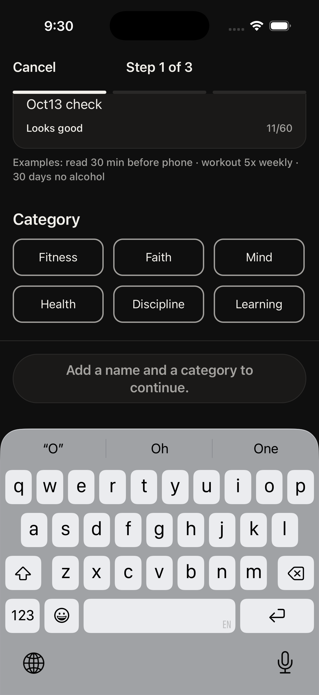
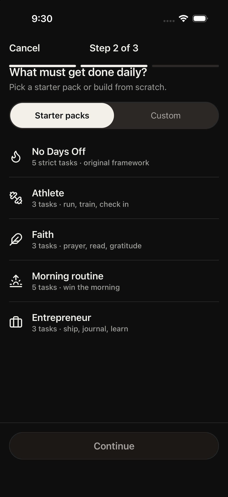

# Build 88 diagnosis — 13 Oct 2026

Phone bugs are from TestFlight build 88, commit `42c3f4cf` on `feat/build88`. Line numbers below are that commit. This report does not change the app.

The simulator is the existing dev client (native build 1) loading that commit’s JavaScript from Metro. It is a fresh guest (`@user_647cca39`), not Yaseen’s phone account, so Morning Prayer, the streak of 6, and the proof grid were not on this device. Those are diagnosed from the code. Where a screen was reached, the screenshot is in `docs/reports/oct13/`.

## Summary

| Bug | Root cause | Size | Shares a cause with |
| --- | --- | --- | --- |
| 1 Likes | Feed double-tap no-ops on your own post and a single tap opens the post; profile posts have no double-tap, and the heart calls `feed.react` then rolls back if the id is not an event uuid | M | 2 (profile id) |
| 2 Profile photo tap | Grid id is `eventId`, or `dateKey-index` when there is no event, and the posts screen `scrollToIndex`s to that id | M | 1 |
| 3 Custom task dropped | Review and save use the starter pack or the custom list, never both | M | 4, 6, 7 |
| 4 Discipline saved as Fitness | Choosing a pack overwrites the step-1 category; Athlete’s category is fitness | S | 3, 6, 7 |
| 5 Invite copy on Review | That sentence is only printed when visibility is PUBLIC. Invite is PRIVATE and should save `challenges.visibility = PRIVATE` | S | — |
| 6 Day 1 today and tomorrow | Step 1 always says today. The database stores `active_challenges.start_at` as now, or tomorrow midnight if today is already secured or a window has closed. The success body still says today | M | 3, 4, 7 |
| 7 Success shows 1 of 3 tasks | The success screen renders `tasks[0]` only | S | 3, 4, 6 |
| 8 Test accounts in Everyone | The feed hides a row only when `profiles.is_test` is true. Maestro’s flag write can fail and the client update is blocked | M | — |
| 9 Best 6 vs Best 3 | Home and Profile read `streaks.longest_streak_count`. Your data recomputes consecutive `day_secures` and ignores freeze days | M | 10, 11, 12 |
| 10 Morning Prayer 6 of 7 vs 5 of 6 | The card counts the day index including today. Your data drops today and clips to the 7-day range | M | 9, 11, 12 |
| 11 16 vs 18 proofs | The grid counts photo check-ins. Your data counts ranged `task_completed` events, and a photo on a self-reported task stays in the self-reported bucket | M | 9, 10, 12 |
| 12 Most often around 12 am | Hour 0 is labeled “12 am”, and the histogram uses the stored profile zone, which wins over the phone and falls back to UTC | M | 9, 10, 11 |
| 13 Everyone hint on Following | The hint renders whenever follows are under 3, with no check of which pill is selected | S | — |
| 14 Guest and “signed in with email” | An anonymous user with no email gets the guest banner and a hardcoded subtitle that says email | S | — |
| 15 Share preview clips | The 1080×1920 card is scaled inside an `overflow: hidden` frame that is shorter than the card | M | — |
| 16 Strict vs Hard | Create, Review, and the detail sentence say Strict. Discover chips say Hard. The stored value is `hard` | S | — |

Two groups cover most of the list.

**Your data is a second scoreboard (9, 10, 11, 12).** Home, Profile, and the proof grid read streak columns, the day index, and photo tiles. Your data rebuilds best streak from `day_secures` only, drops today, clips to 7 days, and buckets proofs by `verification_method` in the stored time zone.

**The create wizard saves a different object than the screen the user just filled (3, 4, 6, 7).** Custom tasks and the pack are exclusive, a pack replaces the category, step 1 ignores `start_at`, and the success screen shows the first task and a today-line that does not follow the title.

## Part B — the bundle and Maestro

Settings → About on this bundle reads **Version 1.0.0 (build 1) · commit 42c3f4c**.



The Metro manifest for this session has `"commit":"42c3f4cf"`. About reads `Constants.expoConfig.extra.commit`, which `app.config.js` sets from `git rev-parse --short HEAD` in the `feat/build88` worktree. Build 1 is the dev client already installed in the simulator. The JavaScript is build 88. The TestFlight binary’s build number is not in this process.

**One flow passed:** `/tmp/griit-about.yaml` on `app.griit.challenge-tracker`, device `ED03BBF2-5118-4E6F-92BE-047AD81637CF`. It tapped “Set this up later”, “No reminders for now”, Profile, Settings, About, and asserted `42c3f4c`. Maestro 2.11.0, about 22s.

**Why the last run died in ~15s:** `maestro` is a shell script that requires Java. Homebrew OpenJDK 27 is at `/opt/homebrew/opt/openjdk` and is not registered with `/usr/libexec/java_home`. With `JAVA_HOME` unset, the script prints “Unable to locate a Java Runtime” and then `[: : integer expression expected` at line 251, and exits before a flow starts. That is the harness, not the app. Export `JAVA_HOME=/opt/homebrew/opt/openjdk` and the same binary runs.

## 1. Likes

**a) Reproduced?** Not by tapping a heart on this guest. The Everyone feed on screen is “started” activity lines, which have no heart (`docs/reports/oct13/home-everyone.png`). The failure is in the code that build 88 ships.

**b) Root cause.** A feed double-tap does nothing on your own post, and the first tap opens the post (`lib/feed-join.ts:17`, `components/feed/DoubleTapRespect.tsx:68`, `components/feed/FeedPostV3.tsx:188`). Profile posts have no double-tap; the heart calls `feed.react` and, on any error, puts the heart back (`app/profile/posts.tsx:79` and `:94`). `feed.react` requires an event uuid and writes `feed_reactions.reaction = 'fire'` (`backend/trpc/routes/feed.ts:645`).

**c) Why the earlier fix never showed up as “likes work”.** Commit `4958238d` (“Fix feed likes by updating the paged feed cache”) is an ancestor of `42c3f4cf`, so it is in this JavaScript. It only made the optimistic update write the paged feed cache so the request is sent. It does not add a double-tap on profile posts, it does not like your own post, and a rejected insert still rolls the heart back (`components/LiveFeedSection.tsx:358`).

**d) Fix.** One like path for the feed and the profile post list: heart and double-tap both call `feed.react` with the activity event id, the first tap on a photo does not navigate, and the heart stays filled unless the server actually rejected the row.

**e) Flow that fails today.**

```yaml
appId: app.griit.challenge-tracker
---
- tapOn: "Show feed from everyone"
- tapOn: "Like"
- assertVisible: "Liked by you.*"
```

## 2. Profile grid tap

**a) Reproduced?** No. This guest has “0 proofs” (`docs/reports/oct13/profile.png`), so there is no tile to tap.

**b) Root cause.** The grid id is the event id, or `dateKey-index` when the check-in has no event (`app/(tabs)/profile.tsx:146`), and that id is what opens the posts screen (`app/(tabs)/profile.tsx:401`), which then calls `scrollToIndex` before the list has laid out (`app/profile/posts.tsx:53`).

**c)** No earlier build claimed this one.

**d) Fix.** Open the post only with a real event id, and do not scroll until the list has reported its size.

**e)**

```yaml
appId: app.griit.challenge-tracker
---
- tapOn:
    point: "88%,91%"
- tapOn: "profile-proof"
- assertVisible: "Posts"
```

## 3. Custom task missing from Review and from the saved challenge

**a) Reproduced?** The exclusive step was reached. Step 2 says “Pick a starter pack or build from scratch” and the Custom segment is the only place with “Add a task” (`docs/reports/oct13/create-step2.png`). A task named in the sheet (`docs/reports/oct13/create-sheet.png`) never reached Review: the Add task button sits under the keyboard and drops out of the accessibility tree once the keyboard is dismissed. The save path is the code below.

**b) Root cause.** Review and the insert both use `useCustom ? customTasks : pack.tasks` (`components/create/CreateWizardV2.tsx:273` and `:344`), so a custom task added and then left behind a selected pack is not saved.

**c)** No.

**d) Fix.** The tasks on Review and the tasks inserted are the ones the user added, including a custom task added on top of a pack.

**e)**

```yaml
appId: app.griit.challenge-tracker
---
- tapOn: "Create"
- tapOn: "Custom"
- tapOn: "Add a task"
- tapOn: "Task name"
- inputText: "Evening journal"
- tapOn: "^Add task$"
- tapOn: "Starter packs"
- tapOn: "Continue"
- tapOn: "Review"
- assertVisible: "Evening journal"
```

## 4. Discipline shows and saves as Fitness

**a) Reproduced?** Step 1 shows a Discipline chip (`docs/reports/oct13/create-step1-typed.png`). Review was not reached. The overwrite is in `setPack`.

**b) Root cause.** Choosing a pack replaces `category` with the pack’s category (`components/create/CreateWizardV2.tsx:201`), and the Athlete pack’s category is `fitness` (`lib/challenge-packs.ts:221`). The server stores `categories[0]` as sent (`backend/trpc/routes/challenges-create.ts:277`).

**c)** No.

**d) Fix.** Keep the category chosen on step 1 when a pack is selected.

**e)**

```yaml
appId: app.griit.challenge-tracker
---
- tapOn: "Discipline"
- tapOn: "Continue"
- tapOn: "Athlete"
- tapOn: "Continue"
- tapOn: "Review"
- assertVisible: "Discipline · .*"
```

## 5. Invite shows “Anyone can find and join”

**a) Reproduced?** No. Review was not opened. That exact sentence exists in one place.

**b) Root cause.** `visibilityLabel` prints “Anyone can find and join” only when the value uppercases to PUBLIC (`backend/lib/create-visibility.ts:3` and `:32`). Invite is the PRIVATE radio (`components/create/v2/StepRules.tsx:55`). The default wizard value is PRIVATE (`components/create/CreateWizardV2.tsx:94`).

**c)** No.

**What is saved.** `createVisibility` writes PUBLIC only when the solo request is PUBLIC; otherwise PRIVATE, and a group is always PRIVATE (`backend/lib/create-visibility.ts:14`). That string is `challenges.visibility` (`backend/trpc/routes/challenges-create.ts:284`). Invite should save `PRIVATE` and Review should say “Only people you invite”. If the phone showed the public sentence, the Anyone radio was the value in state at Review.

**d) Fix.** Review’s Visibility row uses the Invite label whenever PRIVATE is selected, and the radio that looks selected is the value that is saved.

**e)**

```yaml
appId: app.griit.challenge-tracker
---
- tapOn: "Invite.*"
- tapOn: "Review"
- assertNotVisible: "Anyone can find and join"
- assertVisible: "Only people you invite"
```

## 6. Day 1 is today, and also tomorrow

**a) Reproduced?** The create step that hardcodes today was opened. The success screen and Home-after-start were not, because Start was not reached. The three strings are in the code.

**b) Root cause.** Step 1 always renders “Day 1 is today” (`components/create/v2/StepBasics.tsx:143`). The success title follows `start_at`, but the body uses “Day 1 of N is today” unless tomorrow and a between-window both apply (`components/create/v2/LaunchedScreen.tsx:77`). Home follows `start_at`.

**The rule and the database.** Day 1 is tomorrow when today is already secured or a required time window has closed (`backend/lib/late-join-window.ts:149`). Otherwise it is now. `active_challenges.start_at` is that instant: `now`, or tomorrow at 00:00 in the profile time zone (`backend/lib/join-challenge.ts:101` and `:123`). `current_day` is stored as 1 either way.

**c)** No.

**d) Fix.** One sentence, taken from `start_at`, on step 1, Review, the success screen, and Home.

**e)**

```yaml
appId: app.griit.challenge-tracker
---
- assertVisible: "Day 1 is today."
- tapOn: "Start the challenge"
- assertNotVisible: "Day 1 of 7 is today"
```

## 7. Success shows 1 of 3 tasks

**a) Reproduced?** Not on the success screen. The renderer only has a slot for the first task.

**b) Root cause.** `launchedFirstCard` sets `first` to `tasks[0]` (`lib/create-launched.ts:40`) and `LaunchedScreen` renders that row only (`components/create/v2/LaunchedScreen.tsx:49` and `:83`).

**c)** No. This is separate from bug 3: even when all three pack tasks are saved, the screen still shows one.

**d) Fix.** List every task that was saved.

**e)**

```yaml
appId: app.griit.challenge-tracker
---
- tapOn: "Athlete"
- tapOn: "Start the challenge"
- assertVisible: "Morning run"
- assertVisible: "Workout"
- assertVisible: "Body check-in"
```

## 8. b87 and b88 accounts in Everyone

**a) Reproduced?** Yes, on this bundle’s Everyone feed. The accessibility tree included “b88only172545, b88every172545 and 1 other started Drink Water Today” and “b87speed212617 started Journal Today” (`docs/reports/oct13/home-everyone.png` is the top of that feed).

**b) Root cause.** A real viewer drops an author only when `is_test` is true, or the display name is “app review” (`backend/trpc/routes/feed.ts:108` and `:161`, `backend/lib/test-authors.ts:14`). If the flag is null or false, they stay in Everyone.

**c)** Build 88 does hide `is_test`. The flag is not on these rows. `claimMaestroTest` is the writer (`backend/trpc/routes/profiles.ts:581`). If that call throws, the client update `profiles.is_test = true` is the fallback (`components/onboarding/v2/screens/AccountScreen.tsx:47`), and profile RLS blocks that update, so the flag stays unset.

**d) Fix.** Set `is_test` with the service role when the email matches `b8*@example.com`, and treat a missing flag as hidden for those emails until the column is true.

**e)** The read-only query is `sql/pending/b87-b88-is-test.sql`. It was not run.

```yaml
appId: app.griit.challenge-tracker
---
- tapOn: "Show feed from everyone"
- assertNotVisible: "b87.*"
- assertNotVisible: "b88.*"
```

## 9. Best streak 6 vs Best 3

**a) Reproduced?** No. This guest’s Home says “Your best” at 0 (`docs/reports/oct13/home-following.png`) and Profile says Best 0. Yaseen’s 6 vs “Best 3 · Oct 7 – Oct 9” is the two counters below.

**b) Root cause.** Home uses `longestStreak`, which is `max(streaks.longest_streak_count, active streak)` (`app/(tabs)/index.tsx:916`, `backend/trpc/routes/profiles-stats.ts:225`). Profile uses `streaks.longest_streak_count` (`backend/trpc/routes/profiles-record.ts:410`). Your data uses `bestStreakRun` on `day_secures` only, so a freeze or a missing secure row ends the run (`backend/lib/me-stats.ts:66` and `:196`).

**c)** No.

**d) Fix.** One streak. If Home counts a freeze-held day, Your data counts it too, and the date range is that same run.

**e)**

```yaml
appId: app.griit.challenge-tracker
---
- assertVisible: "Best 6"
- tapOn: "Your data"
- assertVisible: "Best 6"
```

## 10. Morning Prayer, 6 of 7 vs 5 of 6

**a) Reproduced?** No. This guest has no challenge.

**b) Root cause.** The card is the day index out of the duration, including today. Your data’s enrollment line counts only keys before today and inside the selected range, which defaults to 7 days (`backend/lib/me-stats.ts:186` and `:223`). A 7-day challenge on day 6 with today secured can read 6 of 7 on the card and 5 of 6 in Your data.

**c)** No.

**d) Fix.** The same numerator and denominator on the card and in Your data, and the line says whether today counts.

**e)**

```yaml
appId: app.griit.challenge-tracker
---
- assertVisible: "Morning Prayer"
- assertVisible: "6 of 7"
- tapOn: "Your data"
- assertVisible: "6 of 7"
```

## 11. 7 camera + 9 self-reported vs 18 proofs

**a) Reproduced?** No. This guest’s grid says “0 proofs”.

**b) Root cause.** The grid counts check-ins that have an image and labels that “N proofs”. Your data counts `task_completed` events in the selected range, and `proofMethodFromMetadata` keeps a self-reported or manual task in the self-reported bucket even when a photo URL is set (`backend/lib/me-stats.ts:124` and `:199`). 7 + 9 is that ranged split. 18 is the photo-tile count. They are not the same set.

**c)** No.

**d) Fix.** One proof tally, and a photo on a self-reported task is counted in one bucket only.

**e)**

```yaml
appId: app.griit.challenge-tracker
---
- assertVisible: "18 proofs"
- tapOn: "Your data"
- assertVisible: "18"
```

## 12. “Most often around 12 am”

**a) Reproduced?** No. This guest has no proofs, so the line is hidden (`usualHour` returns null under 5 proofs).

**b) Root cause.** Hour 0 is labeled “12 am” (`lib/v51-format.ts:14`). The histogram hour is `hourInZone` in `resolveStatsTimeZone`, which returns the stored `profiles.timezone` or `reminder_timezone` before the device zone, and UTC when both are empty (`backend/lib/me-stats.ts:101` and `:133`, `backend/trpc/routes/profiles-stats.ts:526`). A stored UTC zone turns an evening in US Eastern into hour 0.

**c)** No.

**d) Fix.** Bucket the hour in the phone’s zone. Do not let a stored UTC default win over the device zone.

**e)**

```yaml
appId: app.griit.challenge-tracker
---
- tapOn: "Your data"
- assertNotVisible: "Most often around 12 am"
```

## 13. “Everyone is on” while Following is selected

**a) Reproduced?** Yes.



**b) Root cause.** The hint is rendered whenever `followingCount < 3`, with no check that Everyone is the selected scope (`components/LiveFeedSection.tsx:732`).

**c)** No. Frame 1533 does want this sentence while Following has fewer than 3 people. The phone report is that it stays up after Following is the selected pill. The code shows it for both pills.

**d) Fix.** Show that line only when the Everyone pill is selected.

**e)**

```yaml
appId: app.griit.challenge-tracker
---
- tapOn: "Show feed from people you follow"
- assertNotVisible: "Everyone is on until you follow 3 people."
```

## 14. Guest banner and “Signed in with email”

**a) Reproduced?** Yes, on this guest.





**b) Root cause.** The banner shows when `user.is_anonymous` is true (`app/settings/index.tsx:66`). The Account subtitle is the literal “Signed in with email” whenever the email string is empty (`app/settings/index.tsx:38`). The Account screen does the same in `maskEmail`, and any non-Apple provider is labeled “email” (`app/settings/account.tsx:11` and `:20`).

**c)** No.

**d) Fix.** If `is_anonymous` is true, Settings and Account say guest, and they show an email only when one is stored.

**e)**

```yaml
appId: app.griit.challenge-tracker
---
- assertVisible: "You're using GRIIT as a guest.*"
- tapOn: "Account"
- assertNotVisible: "Signed in with email"
```

## 15. Share card preview cuts off the bottom

**a) Reproduced?** No. This guest has nothing to share, so the sheet was not opened.

**b) Root cause.** The preview places a 1080×1920 card with a negative top and left inside a frame whose height is `min(480, max(280, screen − insets − 360))`, then scales it, and the frame is `overflow: hidden` (`components/share/ShareSystemSheet.tsx:72`, `:103`, and `:340`). The join line is the last item on the card, so it is what gets cut.

**c)** No.

**d) Fix.** Scale the card so the join line sits inside the frame.

**e)**

```yaml
appId: app.griit.challenge-tracker
---
- tapOn: "Share"
- assertVisible: "griit.app"
```

## 16. Strict vs Hard

**a) Reproduced?** Create step 2 shows “5 strict tasks” on No Days Off (`docs/reports/oct13/create-step2.png`). Discover was not opened. The word split is the list below. The stored value is difficulty `hard` / `is_hard_mode`. Standard/Hard is challenge difficulty. Create renamed the hard side to Strict.

**Strict, product UI**

- `lib/create-mode-copy.ts:7` — `MODE_HARD_TITLE = "Strict"` (step 3 title and Review)
- `lib/challenge-detail-mapping.ts:239` — “Strict. A missed day resets…”
- `components/discover/DiscoverV3.tsx:171` and `:216` — the same sentence on the detail body
- `backend/trpc/routes/streaks.ts:230` — “Strict challenges do not use freezes.”
- `components/create/v2/StepTasks.tsx` pack meta — “5 strict tasks” (No Days Off)

**Hard, product UI**

- `components/discover/DiscoverV3.tsx:100` — chip `HARD` → “Hard”
- `components/discover/grid/ChallengeGridCard.tsx:61` — same
- `components/discover/ChallengeCard.tsx:80` — “Hard”
- `components/challenges/_card-helpers.tsx:54` — “Hard”
- `backend/lib/discover-preview-tasks.ts:32` — “Hard”
- `lib/challenge-end.ts:56` — “Hard mode has no freezes…”
- `backend/lib/checkin-complete-gates.ts` and `backend/trpc/routes/checkins.ts` — error strings “Hard mode: …”
- `lib/share-copy.ts:39` — “ Hard Mode.”

Design handoff copies under `design/` and `griit_brand/` also say Hard. They are not the running app.

**d) Fix.** One word on Create, Review, Discover, and the detail body. The stored value stays `hard`.

**e)**

```yaml
appId: app.griit.challenge-tracker
---
- tapOn: "How strict?"
- assertVisible: "Hard"
- tapOn: "Discover"
- assertNotVisible: "Strict"
```

## Part D — look versus v53

Frames are the text in `design/GRIIT-v53.1-ONLY.md`. The HTML atlas was not screenshotted beside these. Nothing was changed.

### Home (frames 1533, 1534, 1570)


1. The streak card says “Your best” at 0 days. Frame 1534 shows that badge only when the current streak equals the best and is greater than 1.
2. Empty today reads “No challenge yet. Join one and Day 1 is today.” Frame 1534’s secured line is “Day secured. See you tomorrow.”
3. The Following / Everyone control is a custom pill, not the glass switch in the v53.1 note.
4. The tab bar is a solid dark bar with an orange Home icon. Frame 1570 is the iOS 26 glass bar. Acceptable only as the iOS 18 fallback (1574), and this simulator is iOS 26.
5. “Find a challenge” is a full orange primary button. Frame 1533 asks for a “Find friends” row, not that button.

### Profile (frames 1520, 1521, 1522)



1. “Find friends” is a button beside “Edit profile”. Frame 1520 already asks for that; the old “text line” note is stale. The gap under the handle is “Joined Tuesday. Running a challenge.” which 1520 does not list.
2. Stats are two rows (social counts, then streak / best / days) rather than one card under the buttons.
3. Proofs empty state is “No proofs yet.” Frame 1522 specifies the 3-column 4:5 grid, date on the tile, and blurhash. None of that is on screen at zero, which is fine, but the date-on-tile rule is still unmet once proofs exist (the grid is photos only).
4. Selected tab is an underline, not orange. That matches 1521.
5. The share glyph is a circle in the header. Frame 1520’s order is avatar, name, handle, bio, counts, then the two buttons.

### Post screen (frames 1512, 1523, 1530)

Not opened. This guest has no post. Against the code: the profile list is a plain image plus a heart, not the post frame (photo, day line, date, caption, visibility, likes, comments). Double-tap is missing there. The feed post still uses a single tap to open, which frame 1530 forbids so a double-tap can land.

### Share card (frame 1512 action, 1524)

Not opened. No proof to share. The preview clip in bug 15 is the difference: the join line is cut off. Frame 1524 also requires one date formatter on the share card; the preview does not go through `dates.ts`.

### Create (frame 1571, and the wizard is not a v53 frame)





1. Create is a pushed wizard, not the sheet frame 1571 asks for, and the selected tab does change to Create.
2. Orange is the progress ticks and, once enabled, the Continue button. That matches the locked rule (primary fill and the active tab). Chips invert to white, which is correct.
3. Step 2 is an exclusive “Starter packs / Custom” segment. v53 does not describe this wizard; the running copy says “or”, which is bug 3.
4. “5 strict tasks” uses Strict. Discover’s chip for the same difficulty is Hard (bug 16).
5. Step 1 hardcodes “Day 1 is today” under “How long?”, which is bug 6. The duration row was below the keyboard in the shot.
